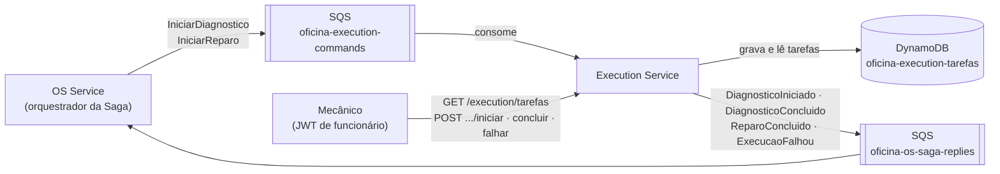
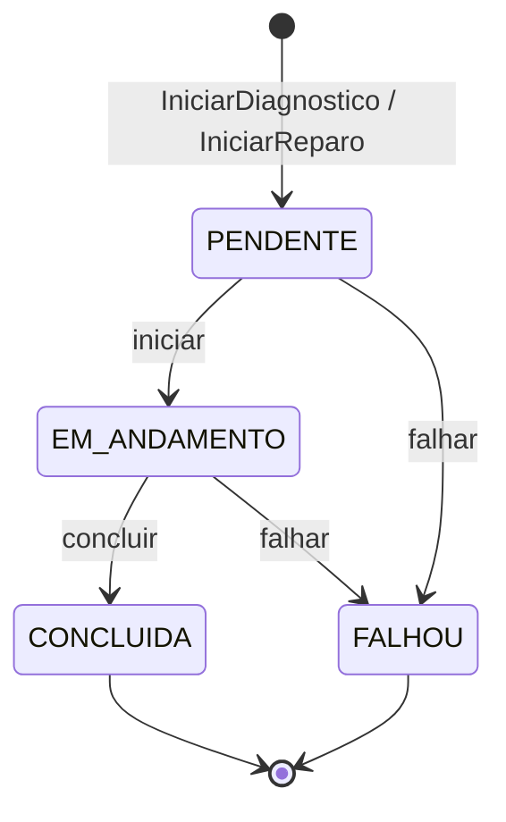
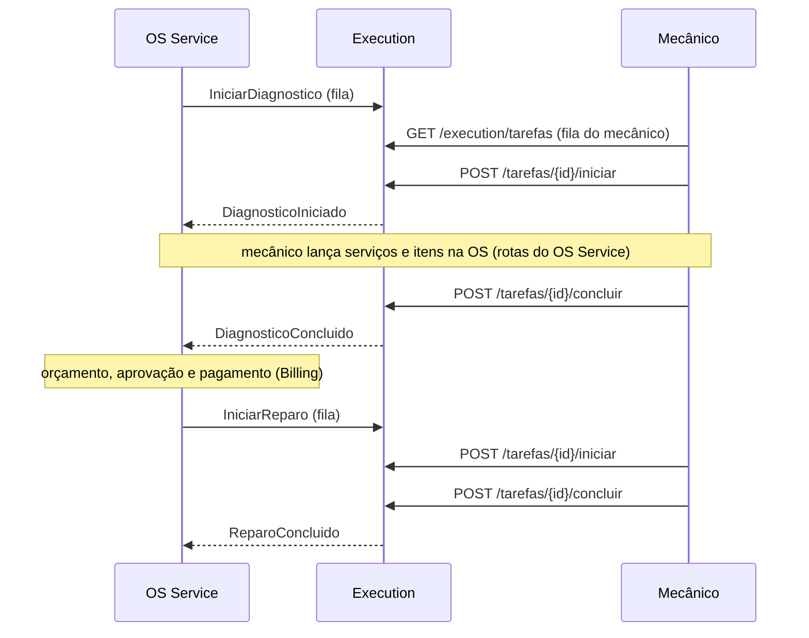
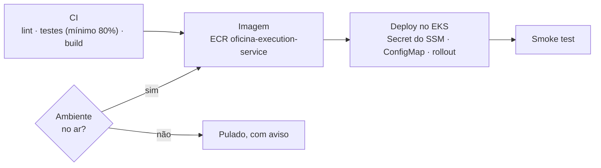

# Execution Service

Fila de diagnóstico e reparo das ordens de serviço.

Microsserviço do Tech Challenge da Fase 4 (FIAP SOAT). A oficina mecânica foi dividida em três serviços: OS Service, Billing Service e Execution Service, com a Saga orquestrada pelo OS Service. Os contratos de mensagens e rotas entre os serviços estão em [docs/contratos.md](https://github.com/LucasValada/tech-challenge-fiap/blob/develop/docs/contratos.md), e este serviço segue esse documento à risca.

| Serviço | Repositório | Banco |
|---|---|---|
| OS Service (orquestrador da Saga) | [LucasValada/tech-challenge-fiap](https://github.com/LucasValada/tech-challenge-fiap) | PostgreSQL |
| Billing Service | [oficina-billing-service](https://github.com/fiap-soat-oficina-tech-challenge/oficina-billing-service) | PostgreSQL |
| Execution Service | [oficina-execution-service](https://github.com/fiap-soat-oficina-tech-challenge/oficina-execution-service) | DynamoDB |

## Sumário

- [Responsabilidades](#responsabilidades)
- [Como funciona](#como-funciona)
- [Ciclo de uma tarefa](#ciclo-de-uma-tarefa)
- [Fluxos da Saga](#fluxos-da-saga)
- [Mensagens](#mensagens)
- [API REST](#api-rest)
- [Garantias](#garantias)
- [Modelo de dados (DynamoDB)](#modelo-de-dados-dynamodb)
- [Arquitetura do código](#arquitetura-do-código)
- [Tecnologias](#tecnologias)
- [Rodando localmente](#rodando-localmente)
- [Testes e cobertura](#testes-e-cobertura)
- [Variáveis de ambiente](#variáveis-de-ambiente)
- [Deploy](#deploy)
- [Fluxo de trabalho](#fluxo-de-trabalho)
- [Decisões e limites](#decisões-e-limites)

## Responsabilidades

- Manter a fila de execução da OS: as tarefas de diagnóstico e de reparo que o mecânico vai atender
- Registrar o andamento de cada tarefa (iniciada, concluída ou com falha)
- Avisar a Saga do diagnóstico iniciado e concluído, do reparo concluído e de qualquer falha

O serviço **não** muda o status da OS. Ele só avisa o OS Service, e o orquestrador decide: gerar o orçamento, finalizar a OS ou compensar.

## Como funciona



1. O OS Service publica `IniciarDiagnostico` quando a OS é aberta, e `IniciarReparo` quando o pagamento é confirmado. O comando traz uma cópia do que o mecânico precisa: código da OS, veículo, observações e, no reparo, os serviços e itens aprovados. O Execution grava a tarefa como `PENDENTE`. Receber o comando não gera resposta, porque a Saga só avança quando o mecânico age.
2. O mecânico consulta a fila (`GET /execution/tarefas`, mais antigas primeiro) e age sobre uma tarefa. Cada ação que interessa à Saga publica uma resposta para o orquestrador:

| Ação do mecânico | Tarefa de diagnóstico | Tarefa de reparo |
|---|---|---|
| `POST /execution/tarefas/{id}/iniciar` | `DiagnosticoIniciado` (a OS vai para `EM_DIAGNOSTICO`) | — (a OS já está `EM_EXECUCAO`) |
| `POST /execution/tarefas/{id}/concluir` | `DiagnosticoConcluido` (o OS trava as linhas e pede o orçamento ao Billing) | `ReparoConcluido` (a OS é finalizada) |
| `POST /execution/tarefas/{id}/falhar` | `ExecucaoFalhou` (o OS devolve o estoque e cancela a OS) | `ExecucaoFalhou` (o OS manda estornar o pagamento, devolve o estoque e cancela a OS) |

Entre o diagnóstico iniciado e o concluído, o mecânico lança os serviços e itens na OS pelas rotas do **OS Service**, que é o dono do catálogo e do estoque. O Execution não guarda nem calcula valores.

## Ciclo de uma tarefa



As transições ficam em [`domain/tarefa.ts`](src/modules/tarefa/domain/tarefa.ts). Uma ação fora dessa ordem responde **409** e não publica nada, como concluir uma tarefa que não foi iniciada ou falhar uma tarefa já concluída. Isso impede, por exemplo, que um `ExecucaoFalhou` tardio cancele uma OS que já passou daquela etapa.

## Fluxos da Saga

Uma OS passa pelo Execution duas vezes, no diagnóstico e no reparo, com o orçamento e o pagamento (Billing) no meio:



O que acontece em cada falha. A compensação no OS e no Billing está em `docs/contratos.md`, seção 6.

| Situação | Quem detecta | O Execution faz | Responde |
|---|---|---|---|
| Comando com dados inválidos (sem veículo, item sem quantidade...) | Execution, ao consumir | não cria a tarefa | `ExecucaoFalhou` (`COMANDO_INVALIDO: ...`) |
| Reparo sem nenhum serviço nem item | Execution, ao consumir | não cria a tarefa | `ExecucaoFalhou` (`REPARO`, `COMANDO_INVALIDO: ...`) |
| O diagnóstico não pode ser feito (veículo não liga, cliente desistiu na oficina...) | mecânico | marca `FALHOU` com o motivo | `ExecucaoFalhou` (`DIAGNOSTICO`) |
| O reparo não pode ser concluído (peça indisponível...) | mecânico | marca `FALHOU` com o motivo | `ExecucaoFalhou` (`REPARO`); o OS manda o Billing estornar |
| DynamoDB ou SQS fora | Execution | nada muda; a mensagem volta para a fila ou a rota responde 500 | — (nova tentativa) |

Nos status em que o mecânico atua (`RECEBIDA`, `EM_DIAGNOSTICO` e `EM_EXECUCAO`), é a rota `falhar` deste serviço que cancela a OS. Nos status em que a OS espera o cliente, quem cancela é o funcionário, pelo OS Service.

## Mensagens

Formato do envelope e payloads em `docs/contratos.md`, seções 3 e 5.

**Consome** (fila `oficina-execution-commands`), pelo caso de uso [`receber-comando.use-case.ts`](src/modules/tarefa/application/use-case/receber-comando.use-case.ts):

| Comando | `payload` | Cria |
|---|---|---|
| `IniciarDiagnostico` | `{ codigo, veiculo: { placa, marca, modelo, ano }, observacoes }` | tarefa `DIAGNOSTICO` |
| `IniciarReparo` | `{ codigo, veiculo, servicos: [{ nome, quantidade }], itens: [{ nome, quantidade }] }` | tarefa `REPARO` |

Um tipo desconhecido é descartado com um log de aviso.

**Publica** (fila `oficina-os-saga-replies`), pelo caso de uso [`transicionar-tarefa.use-case.ts`](src/modules/tarefa/application/use-case/transicionar-tarefa.use-case.ts). Toda resposta leva o `osId` e o `correlationId` do fluxo da OS, que ficam guardados na tarefa:

| Resposta | Quando | `payload` |
|---|---|---|
| `DiagnosticoIniciado` | o mecânico inicia o diagnóstico | `{ iniciadoEm }` |
| `DiagnosticoConcluido` | o mecânico conclui o diagnóstico | `{ concluidoEm }` |
| `ReparoConcluido` | o mecânico conclui o reparo | `{ concluidoEm }` |
| `ExecucaoFalhou` | o mecânico registra falha, ou o comando é inválido | `{ etapa: "DIAGNOSTICO" \| "REPARO", motivo }` |

## API REST

Prefixo `/execution`. A documentação interativa (Swagger) fica em `/execution/api`. Todas as rotas de tarefas exigem o JWT de funcionário emitido por `POST /auth/login` do OS Service. O serviço não emite token, só o valida com o segredo `JWT_SECRET`. Token de cliente recebe 403.

| Método e rota | O que faz |
|---|---|
| `GET /execution/tarefas` | **A fila**: tarefas `PENDENTES`, mais antigas primeiro |
| `GET /execution/tarefas?status=&tipo=&osId=` | Filtra por status (`PENDENTE`, `EM_ANDAMENTO`, `CONCLUIDA`, `FALHOU`), tipo (`DIAGNOSTICO`, `REPARO`) ou OS |
| `GET /execution/tarefas/{id}` | Consulta uma tarefa (404 se não existir) |
| `POST /execution/tarefas/{id}/iniciar` | `PENDENTE → EM_ANDAMENTO` |
| `POST /execution/tarefas/{id}/concluir` | `EM_ANDAMENTO → CONCLUIDA` |
| `POST /execution/tarefas/{id}/falhar` | `PENDENTE` ou `EM_ANDAMENTO → FALHOU`, com `{ motivo }` obrigatório (até 500 caracteres) |
| `GET /execution/health` e `/execution/health/ready` | Liveness (o processo responde) e readiness (a tabela responde) |

As ações respondem a tarefa atualizada; uma ação fora de ordem responde 409.

## Garantias

- **Banco próprio.** As tarefas ficam no DynamoDB deste serviço, que é o banco NoSQL do projeto. Os dados da OS chegam no comando, e o serviço nunca consulta o banco do OS Service.
- **Comando repetido não duplica tarefa.** O SQS entrega cada mensagem pelo menos uma vez. O id da tarefa é um UUID v5 da OS e do tipo ([`domain/id-da-tarefa.ts`](src/modules/tarefa/domain/id-da-tarefa.ts)): o mesmo comando gera sempre o mesmo id. A gravação é condicional (`attribute_not_exists(id)`), então a segunda entrega é recusada pelo DynamoDB e dada como processada. Isso dispensa tabela de mensagens processadas.
- **Concorrência otimista.** Toda mudança de status grava com o status lido na condição (`ConditionExpression: status = <lido>`). Se dois cliques chegam juntos, só o primeiro grava e o segundo recebe 409. Como a resposta é publicada antes da gravação (item abaixo), o segundo clique pode ter publicado uma resposta repetida, que o orquestrador descarta por já estar no estado seguinte.
- **Publica antes de gravar.** A ação do mecânico publica a resposta e só então grava a tarefa. Se a publicação falha, a tarefa não muda e a ação pode ser repetida. Se a gravação falha depois da publicação, o orquestrador recebe uma resposta e a trata como fora de hora, porque confere o estado da OS. É a regra "gravar e publicar juntos" dos contratos, adaptada ao DynamoDB, que não tem transação com o SQS.
- **Falha de negócio vira resposta; falha técnica vira nova tentativa.** Comando inválido responde `ExecucaoFalhou` para o orquestrador compensar, em vez de ficar voltando para a fila. Se o DynamoDB falha, a mensagem só é apagada depois de processada: o SQS a reenvia e, depois de 5 tentativas, a move para a DLQ `oficina-execution-commands-dlq`.
- **Rastreamento.** As linhas de log do consumo carregam o `correlationId` e o `osId` do envelope ([`common/observability/contexto-fluxo.ts`](src/common/observability/contexto-fluxo.ts)), os mesmos do OS e do Billing. É por eles que se acompanha uma OS nos três serviços no New Relic. Nas rotas do mecânico, o `correlationId` da linha é o da requisição, e os eventos de negócio levam o `os_id`. As respostas publicadas levam sempre o `correlationId` do fluxo, guardado na tarefa.

## Modelo de dados (DynamoDB)

Tabela `oficina-execution-tarefas` ([`terraform/dynamodb.tf`](terraform/dynamodb.tf)), cobrança por requisição (`PAY_PER_REQUEST`). Cada item é uma tarefa inteira, com o veículo e as listas de serviços e itens aninhados:

```json
{
  "id": "1f0e...-5...",
  "osId": "c56f9df1-b6f7-4625-84ce-a27706664ae5",
  "codigo": "OS-2026-000001",
  "tipo": "REPARO",
  "status": "EM_ANDAMENTO",
  "veiculo": { "placa": "ABC1D23", "marca": "Fiat", "modelo": "Uno", "ano": 2020 },
  "observacoes": null,
  "servicos": [{ "nome": "Troca de óleo", "quantidade": 1 }],
  "itens": [{ "nome": "Filtro de óleo", "quantidade": 2 }],
  "correlationId": "7d2f0a4e-...",
  "criadoEm": "2026-10-20T14:03:00.000Z",
  "atualizadoEm": "2026-10-20T15:10:00.000Z",
  "iniciadoEm": "2026-10-20T15:10:00.000Z"
}
```

Cada padrão de acesso tem a sua chave, sem varrer a tabela:

| Padrão de acesso | Chave usada |
|---|---|
| Uma tarefa pelo id (rotas de ação e consulta) | chave primária `id` |
| A fila: tarefas de um status, mais antigas primeiro | índice `por-status` (`status` + `criadoEm`) |
| As tarefas de uma OS | índice `por-os` (`osId`) |
| Não duplicar tarefa (idempotência) | `id` determinístico + `attribute_not_exists(id)` |

**Por que DynamoDB.** O PDF exige pelo menos um banco NoSQL, e este é o serviço em que ele se encaixa naturalmente:

- a tarefa é um documento autocontido (veículo e listas aninhados), lido e gravado inteiro, sem junções;
- os acessos são poucos e conhecidos: por id, por status e por OS;
- a idempotência sai da própria chave, com escrita condicional;
- é gerenciado e cobrado por requisição, sem servidor de banco para manter.

Os dados que precisam de transações e de consistência relacional (dinheiro, estoque, OS) ficam nos PostgreSQL do OS e do Billing.

## Arquitetura do código

Arquitetura limpa, no mesmo padrão de módulos do OS Service (`domain`, `application`, `infra`, `interface`). Os casos de uso dependem só de **portas** (o repositório de tarefas e o publicador de respostas), e as implementações (DynamoDB e SQS) são ligadas no módulo do Nest. Por isso os testes dos casos de uso rodam com dublês em memória, sem AWS.

```
src/
  common/
    aws/              clientes do SQS e do DynamoDB
    mensageria/       envelope, consumidor SQS (long polling, só apaga depois de processar) e publicador
    observability/    New Relic, eventos de log e contexto do fluxo (correlationId do envelope)
    guards/           JWT com papéis
  core/config/        validação das variáveis de ambiente e prefixo das rotas
  modules/
    health/           liveness e readiness (DescribeTable)
    tarefa/
      domain/         tarefa, ciclo de estados, id determinístico, erros e porta do repositório
      application/
        ports/        publicador de respostas, nomes dos comandos e das respostas
        use-case/     receber comando, transicionar tarefa, consultar tarefas
        shared/       erros de domínio → HTTP
        dto/          entradas e respostas da API (Swagger)
      infra/          repositório no DynamoDB
      interface/
        controller/   rotas do mecânico
        consumer/     consumidor da fila de comandos
k8s/                  namespace, ConfigMap, Deployment, Service, HPA, Ingress e PDB
terraform/            fila, DLQ, tabela, ECR e permissões
localstack/           criação das filas e da tabela no LocalStack
scripts/              teste de ponta a ponta
```

A base comum (`common/`, `core/`, `auth`, `health`) é a mesma nos três serviços. Mudanças nela devem ser feitas nos três.

## Tecnologias

NestJS 11 · TypeScript · Node.js 24 · Amazon DynamoDB · Amazon SQS · AWS SDK v3 · Jest · logs JSON com `nestjs-pino` e `correlationId` · agente New Relic · Docker · LocalStack · Kubernetes (EKS) · Terraform · GitHub Actions

## Rodando localmente

Com Docker, o compose sobe o LocalStack com as mesmas filas e a mesma tabela do Terraform ([`localstack/init/criar-recursos.sh`](localstack/init/criar-recursos.sh)) e inicia o serviço:

```bash
cp .env.example .env    # ajuste JWT_SECRET para o mesmo segredo do OS Service
docker compose up --build
```

- Saúde: `http://localhost:3002/execution/health/ready`
- Swagger: `http://localhost:3002/execution/api`

O LocalStack fica na versão 4.0 fixa, porque as imagens mais novas podem exigir token de conta.

Sem Docker para o serviço (o LocalStack ainda é necessário): `docker compose up -d localstack`, depois `npm ci && npm run start:dev` (porta 3000).

### Teste de ponta a ponta

Com o compose no ar, [`scripts/teste-ponta-a-ponta.sh`](scripts/teste-ponta-a-ponta.sh) faz o papel do OS Service: publica comandos na fila, lê as respostas da Saga e chama as rotas como o mecânico.

```bash
bash scripts/teste-ponta-a-ponta.sh
```

São 27 verificações em quatro cenários:

1. diagnóstico do comando até a conclusão, com a idempotência do comando repetido e as ações fora de ordem (409);
2. reparo do comando até a conclusão;
3. falhas registradas pelo mecânico no diagnóstico e no reparo;
4. comandos inválidos e de outra fila.

O script também confere a autenticação: sem token é 401 e token de cliente é 403.

## Testes e cobertura

```bash
npm test            # testes unitários
npm run test:cov    # com cobertura; falha abaixo de 80% de linhas e instruções
```

Resultado atual: **122 testes, 98,9% de linhas** (98,8% de instruções, 90,4% de branches, 98,9% de funções). Os dublês usados pelos testes (`testes-de-apoio.ts`) ficam fora da conta, para não inflar o número.

| Camada | O que os testes cobrem |
|---|---|
| Domínio | ciclo da tarefa (transições válidas e recusadas) e o UUID v5 (determinístico e no formato da RFC 4122) |
| Casos de uso | cada linha da tabela [Fluxos da Saga](#fluxos-da-saga), com dublês em memória: idempotência, validação do comando, publicação antes da gravação, corrida entre duas ações |
| Infraestrutura | consultas ao DynamoDB (índice certo por filtro, paginação, escrita condicional) e o consumidor SQS (só apaga depois de processar, mensagem fora do formato, parada limpa) |
| Interface | rotas e ligação da fila aos casos de uso |

O CI (`.github/workflows/ci.yml`) roda lint, testes com cobertura e build em todo PR; o check `Build & Test` é obrigatório para o merge na `main`. No push na `develop` e na `main`, o mesmo CI roda como primeiro estágio do [deploy](#deploy).

## Variáveis de ambiente

| Variável | Uso |
|---|---|
| `JWT_SECRET` | Mesmo segredo do OS Service e da Lambda de autenticação |
| `AWS_REGION` | Região da AWS |
| `EXECUTION_COMMANDS_QUEUE_URL` | Fila consumida |
| `SAGA_REPLIES_QUEUE_URL` | Fila das respostas para o orquestrador |
| `DYNAMODB_TABLE_TAREFAS` | Tabela de tarefas |
| `AWS_ENDPOINT_URL` | Só localmente: aponta para o LocalStack |

As credenciais da AWS vêm da role dos nós do EKS (cadeia padrão do SDK), não de variável.

## Deploy

O deploy é automático, pelo workflow `.github/workflows/cd.yml`, a cada push na `develop` e na `main`. As duas branches vão para o mesmo cluster.



| Estágio | O que faz |
|---|---|
| CI | O mesmo workflow dos PRs (`ci.yml`). Se falhar, nada é publicado. |
| Ambiente na AWS | O ambiente só existe nas janelas de integração e demonstração. Sem o secret `AWS_ROLE_ARN` ou sem o cluster `tc3-oficina-homolog`, a imagem e o deploy são pulados com um aviso no resumo da execução. Qualquer outro erro falha o pipeline. |
| Build & Push (ECR) | Imagem `linux/amd64` com duas tags: o commit e a branch. |
| Deploy (EKS) | Monta o Secret `execution-secret` a partir do SSM (`JWT_SECRET` e a license key do New Relic), aplica o ConfigMap e depois Deployment, Service, HPA, Ingress e PDB, esperando o rollout. Um deploy por vez. |
| Smoke test | Readiness com a tabela do DynamoDB, rota protegida respondendo 401 sem JWT e o HPA com ao menos duas réplicas. Não grava dados: o fluxo com os outros serviços é conferido pelo smoke test do OS Service. |

Os manifestos ficam em `k8s/`, no namespace `oficina-execution`, numerados na ordem de aplicação. O Ingress compartilha o ALB dos três serviços (`group.name: oficina`) e encaminha `/execution` para este serviço. A readiness checa a tabela: um pod sem acesso ao DynamoDB sai do Service, mas não é reiniciado.

A infraestrutura AWS do serviço (fila, tabela, repositório de imagens e permissões) está em [`terraform/`](terraform/README.md). O pipeline assume a role `tc3-github-actions` por OIDC, sem chave de acesso guardada no GitHub. O secret `AWS_ROLE_ARN` é o ARN dessa role, e o repositório precisa estar na lista de repositórios aceitos por ela (`bootstrap/` de `tc3-infra-k8s`).

## Fluxo de trabalho

- Branch a partir da `develop` → PR para a `develop` → PR da `develop` para a `main`.
- A `main` é protegida: exige PR com uma aprovação, o check `Build & Test` verde e a branch atualizada, e vale também para administradores.
- Mudança de contrato (mensagem, fila ou rota usada por outro serviço) começa por um PR em `docs/contratos.md` no OS Service, e só depois é feita nos serviços.
- Mudança na base comum (`src/common/`, `src/core/`, `auth`, `health`) é feita nos três serviços.

## Decisões e limites

- **Uma tarefa por OS e tipo.** É a chave natural da idempotência. Uma OS que falhou é cancelada pela Saga, então nunca precisa de um segundo diagnóstico ou reparo.
- **Iniciar o reparo não gera resposta.** A OS já está `EM_EXECUCAO` desde o pagamento, e o contrato não tem um evento para isso. A tarefa registra `iniciadoEm` para consulta.
- **Sem atribuição de mecânico.** A fila é única e qualquer funcionário pode agir sobre qualquer tarefa, como no OS Service da Fase 3. Atribuir tarefas a um mecânico não é requisito.
- **Publicar antes de gravar, sem transação.** O DynamoDB não participa de transação com o SQS. A ordem escolhida garante que nada fica gravado sem a resposta correspondente. O caso inverso (resposta publicada e gravação com falha) é tratado pelo orquestrador como mensagem fora de hora.
